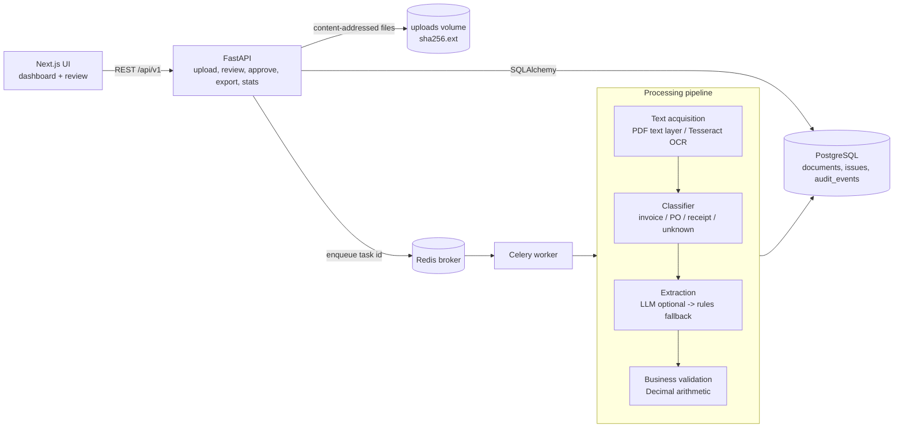
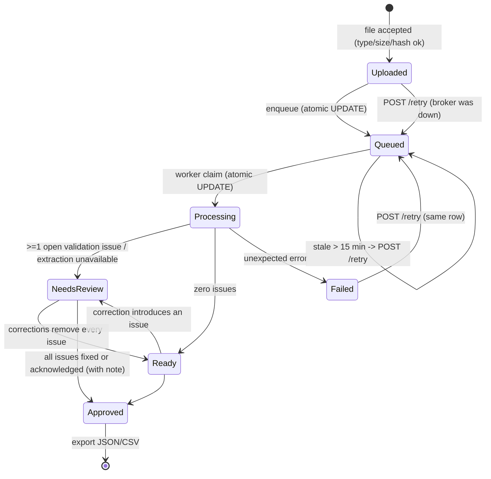
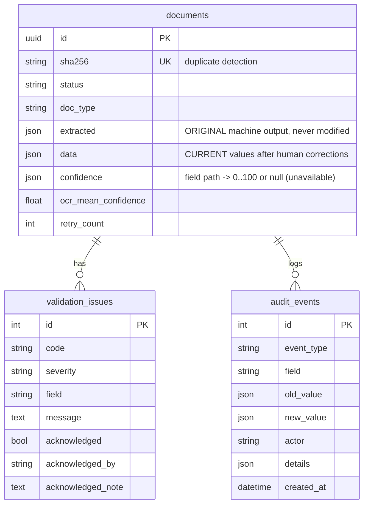

# Architecture, decisions and trade-offs

## 1. Component diagram

## 2. Document state machine

(`Needs Review` = status "Needs Review", `Ready` = "Ready for Approval".)

## 3. Data model (full DDL: `docs/schema.sql`, generated with `pg_dump -s`)

## 4. Requirement-driven design decisions

| Decision | Why (what to say in the technical review) |
|---|---|
| **Content hash (SHA-256) with a UNIQUE index** | Duplicate detection is enforced by the database, so two concurrent identical uploads cannot both win; the loser catches `IntegrityError` and returns the existing document. Duplicates never reach the queue. |
| **Atomic `UPDATE ... WHERE status = X` for every transition** (enqueue, worker claim, retry, approve) | Compare-and-swap in SQL gives exactly-once processing semantics without locks: a re-delivered Celery task (`acks_late`) or a double-clicked Retry/Approve is a no-op. A retry re-uses the same row, so it can never create duplicate records. |
| **Original vs current values (`extracted` / `data`) + append-only `audit_events`** | The brief demands original *and* revised values be preserved. `extracted` is written once by the pipeline; corrections only touch `data` and emit one `field_corrected` event per field with old/new/actor. |
| **Money as decimal strings + `decimal.Decimal`** | No binary floats anywhere (test `test_decimal_arithmetic_not_float`). Tolerance of 0.01 absorbs rounding of per-line prices. |
| **Text layer first, OCR second** | Digital PDFs give exact text (no OCR error); only images and scanned PDFs go through Tesseract. Confidence is `null` ("unavailable") for text layers, per the brief, and real per-line Tesseract confidence otherwise. |
| **Extraction chain: LLM (optional) -> rules -> manual review** | Satisfies "attempt fallback extraction or mark for manual review". The system is fully functional offline; every failed extractor is audited (`extractor_failed`). |
| **LLM grounding before validation** | `app/grounding.py` verifies each non-null LLM scalar and line-item leaf against OCR/PDF source text. Dates and decimal numbers allow formatting normalization; line-item numbers must be evidenced on the matched description line. Rejected values become `null`, confidence stays unavailable, and an `UNGROUNDED_VALUE` error routes to review. This is lexical evidence, not semantic proof; a misread OCR token can still be wrong. |
| **Nulls, never guesses** | Rule extractor only returns what is anchored to a label; absent values stay `null`. LLM output is schema-validated and then grounded; its prompt alone is not treated as a security control. |
| **"Fail towards a human"** | Any doubt (missing/invalid field, arithmetic mismatch, low OCR confidence, unparsed line, unknown type, no extractor) -> `Needs Review`. Nothing uncertain can reach `Ready for Approval` silently. |
| **Approval gate** | `POST /approve` returns 409 with the list of unresolved issues unless each is fixed (re-validation removes it) or explicitly acknowledged with a note; acknowledgements are audited and exported. Export is blocked (409) until `Approved`. |
| **OCR repair is visible** | `25:50 -> 25.50` is repaired but confidence is capped at 50, producing `LOW_CONFIDENCE` so a human confirms the guess (found by running sample #4). |
| **Upload hardening** | Type decided by magic bytes AND extension (client MIME ignored); size streamed with a hard cap (413); files stored under `sha256.ext` (path traversal impossible); CSV export neutralises formula injection. |
| **Schema management: startup `create_all` + checked-in `schema.sql`** | `create_all` supports a clean assessment startup; `docs/schema.sql` is the reviewed PostgreSQL DDL snapshot. They are not an upgrade migration system: existing deployments must not rely on `create_all` to apply column changes. Production should adopt versioned Alembic migrations and test upgrades from each supported schema revision. |
| **Celery + Redis (AOF on)** | Recommended stack; AOF persistence means queued jobs survive a Redis restart, and `stale_job_minutes` recovery covers any lost task. |
| **Integration readiness (ERP/CRM)** | Versioned REST (`/api/v1`), OpenAPI (`docs/openapi.json`), stable JSON export containing original + final values + acknowledged issues, decimal strings for exact money, UUID ids. |

## 5. Extraction details

* **Classifier**: weighted keyword scoring; header lines count double; confidence = share of the winning score x strength; below a minimum score -> `unknown`.
* **Rule extractor**: label-anchored regexes for number/date/supplier/customer/currency/totals; line items are parsed *right-to-left* (last 2-3 numeric tokens = qty, unit price, amount) so descriptions containing digits are safe. Dates with `/` or `.` are **day-first** (documented assumption for Sri Lanka); invalid dates (31/02/2026) are kept raw so validation reports them instead of hiding them.
* **Validation codes**: `MISSING_FIELD`, `INVALID_VALUE`, `LINE_TOTAL_MISMATCH`, `SUBTOTAL_MISMATCH`, `TOTAL_MISMATCH`, `FUTURE_DATE`, `LOW_CONFIDENCE`, `POOR_SCAN_QUALITY`, `UNPARSED_LINE`, `UNKNOWN_DOCUMENT_TYPE`, `EXTRACTION_NOT_SUPPORTED`, `EXTRACTION_UNAVAILABLE`.
  Total check: `subtotal (or sum of lines) - discount + tax == total`.
